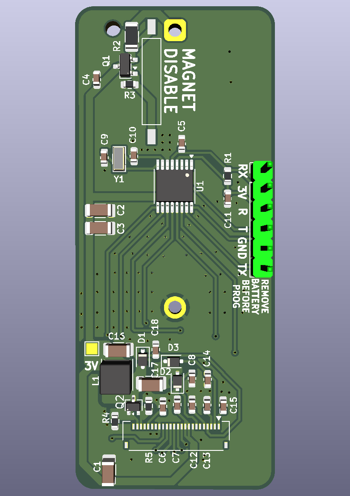
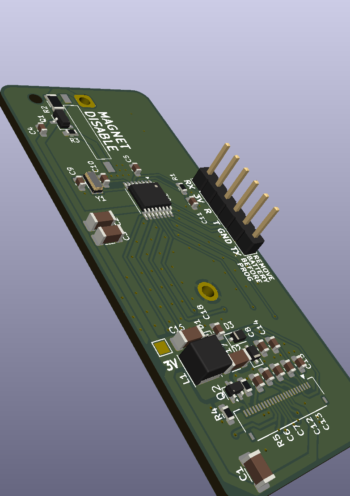

# ocn-ePaper

A battery-powered elapsed-time counter with a 2.13-inch e-paper display and a magnetic off switch.
While a magnet sits at the marked end, the board is switched off. Take the magnet away and it powers
up and counts elapsed time in hours and minutes, up to 99:59 (about 100 hours). Put the magnet back
and it powers down several seconds later, leaving the last count on the display; the next time the
magnet comes off, counting starts again from 00:00.

It is the e-paper version of [ocn-LCD](https://github.com/z2amiller/ocn-LCD), which uses a segment
LCD.

The renders leave out the e-paper panel (it lies over the front), its socket, the reed switch and the
CR123A holder (on the back), which have no 3D models. They show a header in J1, which stays empty on
a finished board.

Status: revision 0.1, not yet built. Firmware will be added to this repository. The folded tail's pin
order has not yet been checked against a real panel.

## How it works

- **Counting.** An MSP430FR2111 keeps time from a 32.768 kHz crystal. It spends almost all its time
  in its deepest sleep mode with only the clock running, and wakes to update the display.
- **Display.** The panel is a Good Display GDEY0213B74: 2.13 inches, 250 × 122 pixels, black and
  white. E-paper holds its image with no power at all, so the panel sleeps between updates, and the
  last count stays on the screen after the board powers down. Updating it takes higher positive and
  negative voltages. The panel's own controller makes them with a small boost converter on the board
  (L1, Q2, D1–D3), which runs only during an update.
- **Mounting.** The panel lies display-up over the front of the board, 3 mm above it, with its tail
  folded under it into a socket (DS2) on the board. Every part on the front fits under it; the
  tallest, L1, is 2.6 mm.
- **Power.** A CR123A lithium cell (3 V, about 1,500 mAh) in a holder on the back.
- **Magnet switch.** The magnet closes a normally open reed switch (SW1). That pulls the gate of a
  P-channel MOSFET (Q1) up to the cell voltage and cuts power to everything after it. With the
  magnet away, a 10 MΩ resistor pulls the gate low and the board runs. While switched off, the only
  drain on the cell is that resistor, about 0.3 µA.
- **Reset on purpose, not by accident.** About 20 µF of capacitance after the switch keeps the board
  running for several seconds after the magnet arrives (roughly 5–15 s, depending on the panel's
  sleep current), so a brief knock or switch bounce does not reset the count. Leaving the magnet in
  place longer than that powers the board down. If the magnet arrives during a display update, which
  draws about 3.5 mA, the board stops within milliseconds and the image may be left half-updated
  until the next power-up.

## Power budget

Estimates at 3.0 V and 25 °C, from the TI datasheet (SLASE78) and Good Display's spec for the panel.
They will be replaced by measurements once the firmware is in.

| Item | Counting (magnet away) | Off (magnet in place) | Basis |
|---|---|---|---|
| MCU asleep (LPM3.5), with the 32 kHz crystal and RTC running | 0.44 µA | 0 | Datasheet 0.66 µA typical with the supervisor (SVS) on; turning it off saves about 0.22 µA |
| Panel controller in deep sleep between updates | 1 µA (5 µA max) | 0 | Good Display spec |
| Display updates, once a minute | ~50 µA | 0 | 3.5 mA while updating, 0.42 s for a partial update and 3 s for a full one, with a full refresh after every five partial ones as Good Display recommends |
| MCU awake for each update (writing the image, waiting on BUSY) | ~0.2 µA | 0 | ~10 ms at ~1 mA per update, then light sleep while the panel updates |
| Gate pull-down R3 (10 MΩ across the cell while the reed is closed) | 0 | 0.3 µA | 3.0 V / 10 MΩ |
| Q1 MOSFET leakage while off | – | a few nA | Typical; the datasheet maximum is specified at 30 V |
| Hold-up capacitors, leakage | ~1 nA | 0 | MLCC insulation resistance |
| Reset pull-up, reed switch, unused pins (driven low) | 0 | 0 | No DC path |
| **Total** | **about 52 µA** | **about 0.3 µA** | |

The display updates dominate. One partial update uses as much charge as about 17 minutes of sleep,
and a full refresh as about 2 hours, so the update rate sets the battery life.

Estimated runtime on one CR123A (1,500 mAh nominal), allowing about 1 %/year for the cell's own
self-discharge:

| Mode | Average draw | Estimated runtime |
|---|---|---|
| Counting, display updated once a minute | about 52 µA | about 3 years |
| Counting, display updated every 10 minutes | about 6–10 µA | over 10 years |
| Off (magnet in place) | about 0.3 µA | decades |

The last two are longer than a CR123A's rated shelf life of about 10 years, so in practice the cell's
age sets the limit, not this circuit. Cold reduces the cell's usable capacity, and the panel is
specified to update only between 0 and 50 °C.

Firmware choices that keep it there:
- Update the count once a minute at most; slower updates last much longer.
- Use partial updates, with a full refresh after every five to keep ghosting down.
- Put the panel in deep sleep after each update, and sleep in LPM3 while BUSY is high. Check BUSY
  again after its falling edge wakes the MCU, before sending the next command.
- Leave the voltage supervisor (SVS) off in LPM3.5; it costs about 0.2 µA. The brownout reset stays
  on regardless.
- Keep the panel's RES line driven while the panel is in use, and drive every unused pin low.

## Placing the magnet

The reed switch is at the end marked MAGNET DISABLE and runs along the length of the board. It
responds to field along its own length, so use a magnet magnetized through its flat faces (a
neodymium cylinder or disc), at that end, with its axis along the board and its face toward the
board's end. SW1's axis is 3.2 mm from the board's centreline, so a magnet centred on the board's end
lines up with it closely. A model of a typical 10 × 8 mm N42 cylinder (no nearby steel) gives several
times the switch's ~2–3 mT pull-in out to about 20 mm, even 9 mm off the switch's axis.

**Steel nearby.** The CR123A's case is steel, and it sits on the back directly behind the switch.
That changes the field around the switch, and its effect hasn't been measured yet. Check the
switching distance on the bench with a cell fitted.

The switch lets go only once the magnet is a few centimeters away (the same model puts it at about
35–40 mm in line), so move the magnet well clear to start counting.

## Key parts

| Ref | Part | LCSC |
|---|---|---|
| U1 | TI MSP430FR2111IPW, TSSOP-16 | C2052845 |
| DS2 | Good Display GDEY0213B74 2.13" e-paper panel, in a Hirose FH34SRJ-24S-0.5SH socket | C324726 (the socket) |
| BT1 | MYOUNG BH-123A-A1CJ002 CR123A holder, through-hole | C5290177 |
| SW1 | Littelfuse 59170-1-S-00-D reed switch, normally open, 10–15 AT | C315909 |
| Q1 | AO3401A P-channel MOSFET, SOT-23 (power switch) | C15127 |
| Q2 | Vishay Si1308EDL N-channel MOSFET, SOT-323 (display booster) | C469327 |
| L1 | Changjiang FNR4030S470MT 47 µH inductor, 4 × 4 mm | C167888 |
| D1–D3 | 1N5819WS Schottky diode, SOD-323 | C191023 |
| Y1 | 32.768 kHz crystal, 3215, 12.5 pF | C32346 |

Every part in the BOM carries its LCSC number. The panel itself comes from Good Display; DS2's BOM
line is its socket. J1 and TP3 are left out of the BOM and the placement file, and so are BT1 and
SW1, which are fitted by hand. The passives are 0603 and 1206.

## Assembly

1. **Surface-mount parts, all on the front.** A stencil helps with the 0.65 mm pitch MCU. The reed
   switch is rated for reflow and can go on with the rest.
2. **CR123A holder on the back, by hand.** Trim its two pins close on the front afterwards. Untrimmed,
   they stand about 2.5 mm proud, under a panel that sits 3 mm up.
3. **Program the MCU** (see below). J1 ends up under the panel, so do this before the panel goes on.
4. **Panel.** Open the socket's latch and slide the tail in, with the panel lying face down beyond the
   end of the board nearest the socket, then close the latch. Fold the panel over onto a 3 mm spacer on the front, so it lies
   display-up over the board. Double-sided foam tape works as the spacer and keeps pressure off the
   glass.
5. **Battery.** Fit the CR123A last, matching the + and − marks on the back.

## Programming

The MCU is programmed over Spy-Bi-Wire from the eZ-FET programmer on a TI MSP-EXP430FR4133
LaunchPad. Any MSP430 LaunchPad with an eZ-FET should also work. J1, on the board's long edge,
carries the four programming signals plus the MCU's serial port. It is a row of six 0.1-inch holes
that stays empty: the panel covers it once fitted.

1. **Take the cell out.** The LaunchPad powers the board at 3.3 V. With the magnet away, Q1 is on
   and would pass that straight back into the cell, and a CR123A must never be charged. The
   silkscreen beside J1 says so too.
2. **Pull every jumper off the LaunchPad's J101 isolation block.** That disconnects the
   LaunchPad's own MCU, so the eZ-FET talks only to this board.
3. **Connect J1.** Push a straight 6-pin header into J1's holes without soldering it, holding it
   tilted slightly so the pins press against the hole walls. Wire it to J101 with dupont jumpers,
   using the J101 pins on the eZ-FET (emulator) side, not the side that runs to the LaunchPad's own
   MCU:

   | ocn-ePaper J1 | LaunchPad J101, eZ-FET side |
   |---|---|
   | 3V | 3V3 |
   | R | SBW RST |
   | T | SBW TST |
   | GND | GND |
   | RX (optional, serial) | RXD |
   | TX (optional, serial) | TXD |

   The serial names match straight across. J101 labels its pins from the target MCU's point of
   view, so its RXD carries data into this board's RX.

4. **Flash the firmware** with TI UniFlash or Code Composer Studio. Select the MSP430FR2111 and the
   LaunchPad's eZ-FET as the connection. A command-line recipe will come with the firmware.
5. **Unplug the LaunchPad before measuring current or fitting the cell.** The programming and
   serial lines draw current of their own.

**Serial port.** RX and TX are on P1.2 and P1.3. They share the MCU's only serial block with the
panel's SPI, so firmware switches the block between the two.

**Measuring battery current.** R2 (1 Ω, 1206) sits in series with the cell. Lift it and connect a
current meter across its pads. TP3 is a test pad on the switched 3 V supply.

## Files

- `ocn-ePaper.kicad_pro`, `.kicad_sch` and `.kicad_pcb`: the KiCad 10 project. The board is
  27 × 65.3 mm, two layers.
- `lib/`: the board's own symbols and footprints: the MSP430FR2111, the GDEY0213B74 and its
  folded-tail footprint (the socket, plus the panel's outline on the User.Drawings layer), the CR123A
  holder and the reed switch. The project's library tables point at this folder, so the project opens
  without any other library installed.

## License

Licensed under the **CERN Open Hardware Licence Version 2 – Permissive**
(CERN-OHL-P v2). See [LICENSE](LICENSE) and [NOTICE](NOTICE).

You may make, modify, and sell boards from these files, with no obligation to
publish your changes.
