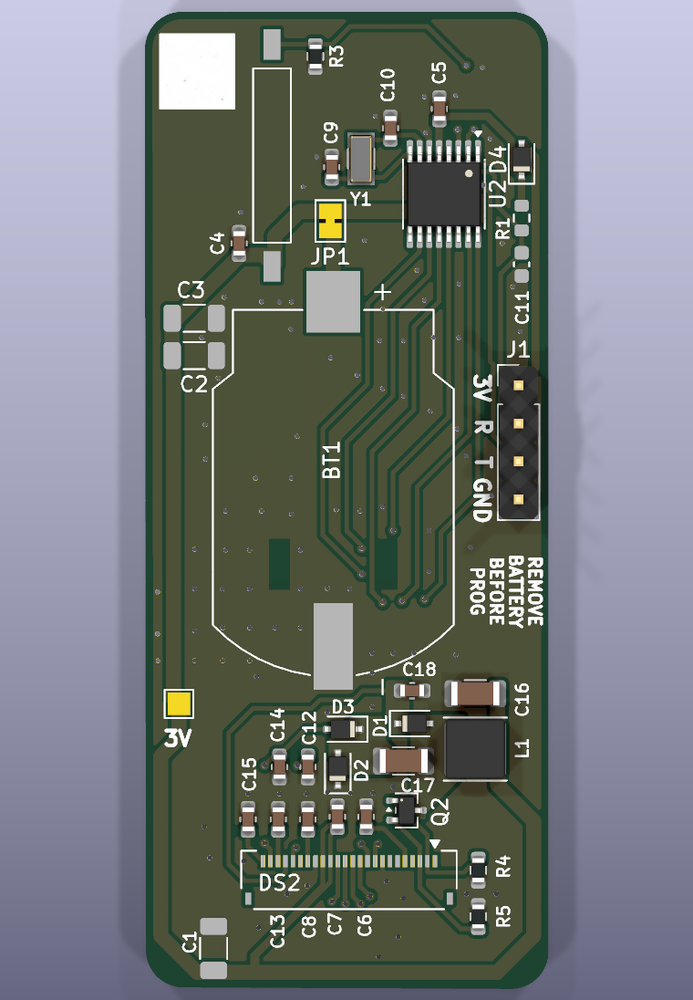
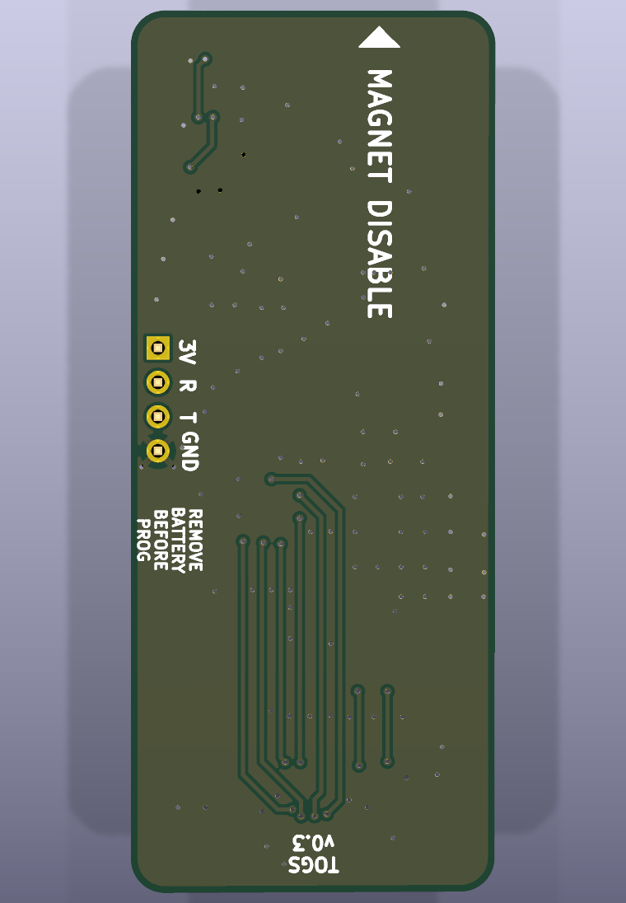
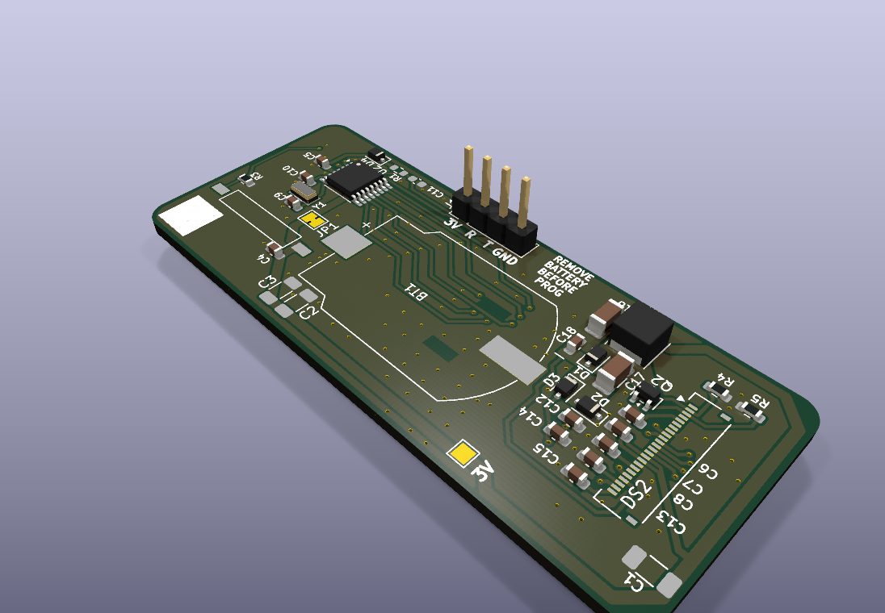

# ocn-ePaper

A battery-powered elapsed-time counter with a 2.13-inch e-paper display and a magnetic switch. Take the
magnet away from the marked end and, 2 seconds later, the board starts counting elapsed time in hours and
minutes from 00:00, up to 99:59 (about 100 hours). Put the magnet back and, 2 seconds later, the count stops
and the display switches to a stored screen showing the stopped time. The board then sleeps at under 1 µA until
the magnet comes off again, which starts a new count from 00:00.

It is the e-paper version of [ocn-LCD](https://github.com/z2amiller/ocn-LCD), which uses a segment
LCD.

The renders leave out the e-paper panel (it lies over the back), the reed switch and the cell holder, which
have no 3D models. They show a header in J1, which stays empty on a finished board.

Status: revision 0.3, built. The first boards came back assembled from JLCPCB in November 2026, and the
firmware in [`firmware/`](firmware/) runs on them: counting, the stored screen and the magnet all work as
described here. Revisions 0.1 and 0.2 used an MSP430FR2111 and a CR123A cell, with the magnet switching the
power; they are in this repository's history (tag `ocn-ePaper-0.2-g2`).

## How it works

- **Counting.** An MSP430FR2422 keeps time from a 32.768 kHz crystal (Y1). It spends almost all its time in
  its deepest sleep mode with only the clock running, and wakes once a minute to update the display.
- **Display.** The panel is a Good Display GDEY0213B74: 2.13 inches, 250 × 122 pixels, black and white.
  E-paper holds its image with no power at all, so the panel sleeps between updates. Each minute is a quick
  partial update; every sixth is a full refresh, which flashes the panel and clears the ghosting partial
  updates leave behind. Updating takes higher positive and negative voltages. The panel's own controller
  makes them with a small boost converter on the board (L1, Q2, D1–D3), which runs only during an update.
  Under the count, a status line shows a battery gauge and voltage and the temperature.
- **Mounting.** The panel is bonded display-out to the back of the board, which is bare: every part is on
  the front. Its tail wraps 180° round the board's bottom edge into a socket (DS2) on the front. The panel
  (59.2 × 29.2 mm) is a little wider than the 27 mm board.
- **Power.** One CR2032 lithium coin cell (3 V, about 225 mAh) in a holder on the front (BT1). There is no
  power switch: the cell stays connected through JP1, a solder jumper that comes bridged and can be cut to
  measure the current.
- **Magnet switch.** The magnet closes a normally open reed switch (SW1), which pulls one of the MCU's pins
  (P1.0) up to the supply; a 10 MΩ resistor (R3) pulls it low otherwise. The board stays powered either way,
  and the firmware reads the pin. A change counts only once the switch has held its new position for 2 s, so
  a magnet brushing past changes nothing. While the magnet is on, R3 draws about 0.3 µA, a third of the
  stored current.
- **Stored.** With the magnet on, the count stops and the stored screen shows the stopped time, which is
  also kept in the MCU's FRAM through any reset. The MCU wakes every 34 minutes and redraws the screen about
  once a week, as Good Display recommends for a panel that keeps showing the same picture. A count that
  reaches 99:59 stays there and is redrawn weekly the same way.
- **Power-up.** Fitting the cell starts a count from 00:00 if the magnet is away, or shows the stored screen
  with the last stopped time if it's on.

The [firmware README](firmware/README.md) covers the details: the screens, the battery gauge, and what
happens when a cell sags too far to finish an update.

## Power

Measured on the first revision 0.3 board, at room temperature, with a fresh CR2032 (3.05 V) in its holder
and a Nordic PPK2 meter in line with it through a cut JP1.

| | Charge | Time |
|---|---|---|
| Partial update, each minute while counting | 1.10 mC | 0.8 s |
| Full refresh: every sixth update, each switch of screen, and the weekly redraw | 3.28 mC | 2.3 s |
| Power-up, before the first full refresh | 0.1 mC | 0.25 s |
| Stored, the MCU's wake every 34 minutes | 0.37 µC | 1.8 ms |
| Asleep between updates, counting | about 0.6 µA | |
| Stored, between wakes, including 0.31 µA through R3 | 0.93 µA | |

- **Counting** averages about 24 µA, over the six-minute cycle of five partial updates and a full refresh.
  The updates are nearly all of it: one partial update costs as much as half an hour asleep. A full count
  from 00:00 to 99:59 uses about 2.4 mAh, about 1 % of the cell.
- **Stored** averages 0.94 µA, wakes and the weekly redraw included: about 8.2 mAh a year. Over a 9.3-hour
  run, every hour averaged between 0.925 and 0.940 µA.

Estimated life on one CR2032, taking 225 mAh and about 1 % a year of the cell's own self-discharge:

| Use | Charge a year | Cell life on paper |
|---|---|---|
| Stored all year | about 10.5 mAh | about 21 years |
| 100 hours of counting a year, stored the rest | about 12.8 mAh | about 17 years |
| 500 hours of counting a year | about 22 mAh | about 10 years |
| Counting all year | about 213 mAh | about 13 months |

A CR2032's shelf life is about 10 years, so below about 500 hours of counting a year the cell's age sets
the limit, not this circuit. Cold reduces the cell's usable capacity and raises its internal resistance,
which matters most during a full refresh, and the panel is specified to update only between 0 and 50 °C.
The battery gauge is read during each update, while the booster loads the cell, so it warns before the
supply could sag under the panel's 2.2 V minimum.

## Placing the magnet

The reed switch is at the end away from the panel's tail, and runs along the length of the board. On the
back, an arrow and the words MAGNET DISABLE mark that end; once the panel is on, it covers the words but not
the arrow. It responds to field along its own length, so use a magnet magnetized through its flat faces
(a neodymium cylinder or disc), at that end, with its axis along the board and its face toward the board's
end. SW1's axis is 5 mm off the board's centreline, on the side away from J1. A model of a typical 10 × 8 mm
N42 cylinder (no nearby steel) gives several times the switch's ~2–3 mT pull-in out to about 20 mm, even
9 mm off the switch's axis.

The switch lets go only once the magnet is a few centimeters away (the same model puts it at about
35–40 mm in line), so move the magnet well clear to start counting, and keep it clear for the 2 s hold.

The cell sits about 12 mm from the switch. A magnet switches the first boards with a cell fitted, but the
switching distances haven't been measured on revision 0.3.

## Key parts

| Ref | Part | LCSC |
|---|---|---|
| U2 | TI MSP430FR2422IPW, TSSOP-16 | C191019 |
| DS2 | Good Display GDEY0213B74 2.13" e-paper panel, in a Hirose FH34SRJ-24S-0.5SH socket | C324726 (the socket) |
| BT1 | Lian Xin BS-CR2032-8 CR2032 holder, surface mount | C7498149 |
| SW1 | Littelfuse 59170-1-S-00-D reed switch, normally open, 10–15 AT | C315909 |
| Q2 | Vishay Si1308EDL N-channel MOSFET, SOT-323 (display booster) | C469327 |
| L1 | Changjiang FNR4030S470MT 47 µH inductor, 4 × 4 mm | C167888 |
| D1–D4 | 1N5819WS Schottky diode, SOD-323 (D1–D3 for the booster, D4 for the programmer's supply) | C191023 |
| Y1 | TKD SF32WK32768D31T002 32.768 kHz crystal, 3215, 12.5 pF | C271654 |

The passives are 0603 and 1206. C1–C3, R1 and C11 are left empty: the board runs without them.

## Ordering

The files for revision 0.3 (tag `ocn-ePaper-0.3-g5`), for JLCPCB's PCB and assembly service:
- [`GERBER-ocn-ePaper.zip`](GERBER-ocn-ePaper.zip): the Gerbers and drill files. The board is 27 × 65.3 mm,
  two layers, 1.6 mm thick.
- [`jlcpcb/production_files/BOM-ocn-ePaper.csv`](jlcpcb/production_files/BOM-ocn-ePaper.csv) and
  [`CPL-ocn-ePaper.csv`](jlcpcb/production_files/CPL-ocn-ePaper.csv): the bill of materials and the
  placement file, all front side.

Every part in the BOM carries its LCSC number except J1, which stays empty. DS2's line is the panel's
socket: the panel itself comes from Good Display. The cell holder and the reed switch are assembled with
everything else.

## Assembly

1. **Surface-mount parts, all on the front**, from the BOM and placement file. A stencil helps with the
   0.65 mm pitch MCU if you build it yourself. The reed switch is rated for reflow and can go on with the
   rest.
2. **Program the MCU** (see below). Once the panel is on, it covers J1's holes on the back, so do this first.
3. **Panel.** Open DS2's latch and slide the tail in, with the panel lying display-up beyond the end of the
   board nearest the socket, then close the latch. Fold the panel under, round the board's end, so it lies
   display-out on the bare back. A thin double-sided tape, about 0.2 mm, holds it there; the footprint's
   bend radius assumes that thickness, and the fold stands about 1.5 mm past the board's end.
4. **Cell.** Fit the CR2032 last, + side up.

## Programming

The MCU is programmed over Spy-Bi-Wire from the eZ-FET programmer on a TI MSP-EXP430FR4133 LaunchPad. Any
MSP430 LaunchPad with an eZ-FET should also work. J1, on the board's long edge, is a row of four 0.1-inch
holes, labelled 3V, R, T and GND on both sides, that stays empty.

1. **Take the cell out.** The LaunchPad powers the board through D4, and with a cell fitted it would push
   current into the cell, which a lithium coin cell must never take. The silkscreen beside J1 says so too.
2. **Pull every jumper off the LaunchPad's J101 isolation block.** That disconnects the LaunchPad's own
   MCU, so the eZ-FET talks only to this board.
3. **Connect J1.** Push a straight 4-pin header into J1's holes without soldering it, holding it tilted
   slightly so the pins press against the hole walls. Wire it to J101 with dupont jumpers, using the J101
   pins on the eZ-FET (emulator) side, not the side that runs to the LaunchPad's own MCU:

   | ocn-ePaper J1 | LaunchPad J101, eZ-FET side |
   |---|---|
   | 3V | 3V3 |
   | R | SBW RST |
   | T | SBW TST |
   | GND | GND |

4. **Flash the firmware.** The [firmware README](firmware/README.md) has the build and a `make flash` that
   uses DSLite from TI's Code Composer Studio; TI UniFlash works too, with the MSP430FR2422 and the
   LaunchPad's eZ-FET as the connection.
5. **Power-cycle the board after flashing.** It shows its first screen straight away, but stays in the
   debugger's session, where it won't count or see the magnet, until the LaunchPad's USB is unplugged and
   plugged in again.
6. **Unplug the LaunchPad before fitting the cell or measuring current.** Its Spy-Bi-Wire lines feed the
   MCU.

**Measuring the current.** JP1, a solder jumper next to Y1, carries all of the cell's current. Cut the bridge
between its pads and connect a current meter across them, the cell side (BT1 +) to the meter's input. TP3,
labelled 3V, is a test pad on the supply after JP1, and J1's GND is ground. Solder the bridge closed
afterwards. `firmware/tools/ppk.py` runs a Nordic PPK2 this way, for seconds or overnight.

## Files

- `ocn-ePaper.kicad_pro`, `.kicad_sch` and `.kicad_pcb`: the KiCad 10 project.
- `lib/`: the board's own symbols and footprints: the MSP430FR2422 (and the FR2111 of the earlier
  revisions), the GDEY0213B74 and its wrapped-to-back footprint (the socket, plus the panel, its tail and the
  fold on the User.Drawings layer), the CR2032 holder and the reed switch. The project's library tables
  point at this folder, so the project opens without any other library installed.
- `firmware/`: the MCU's firmware, MIT licensed. Its README covers building, flashing and how it works.
- `GERBER-ocn-ePaper.zip` and `jlcpcb/`: the fabrication and assembly files (see Ordering).

## License

Licensed under the **CERN Open Hardware Licence Version 2 – Permissive**
(CERN-OHL-P v2). See [LICENSE](LICENSE) and [NOTICE](NOTICE).

You may make, modify, and sell boards from these files, with no obligation to
publish your changes.
